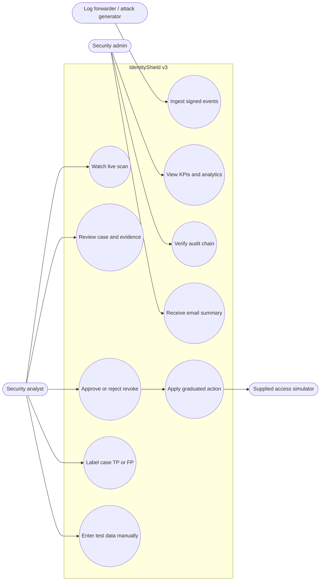
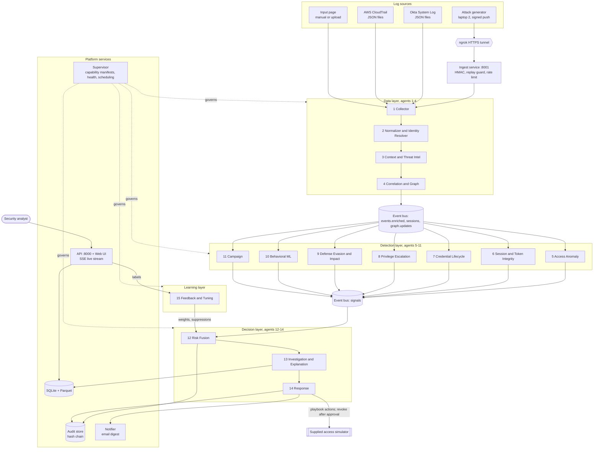
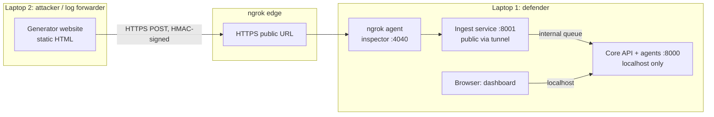
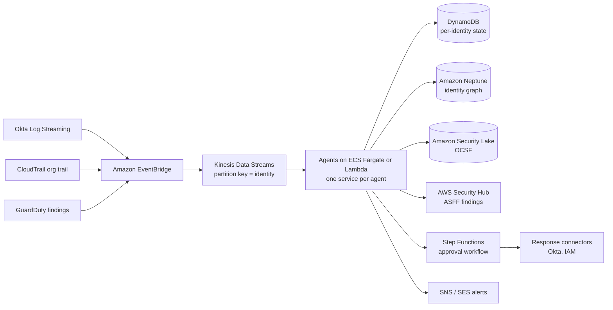
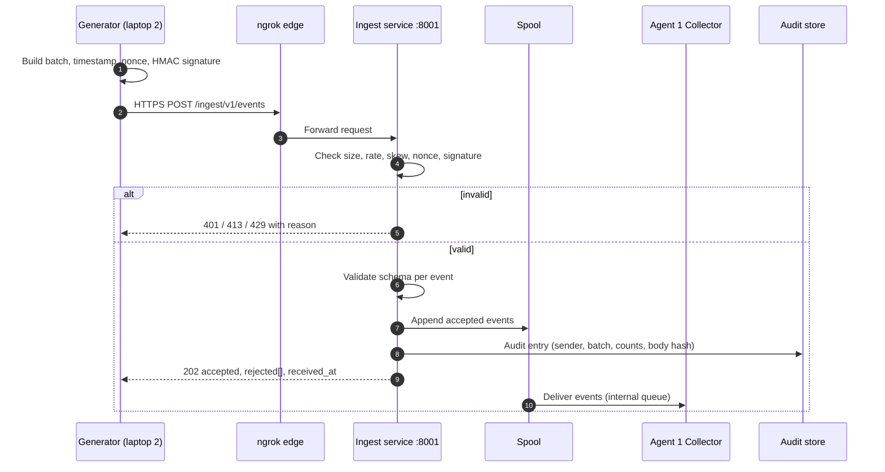
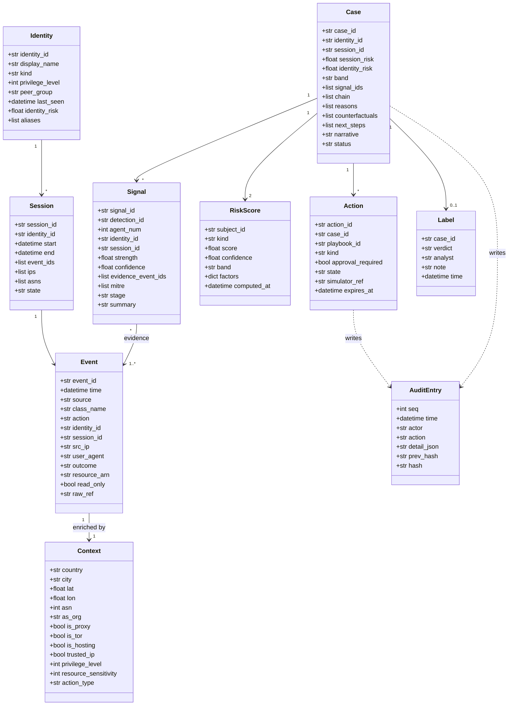
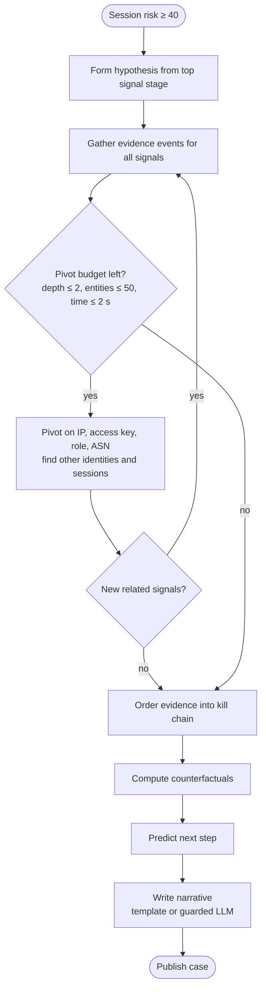
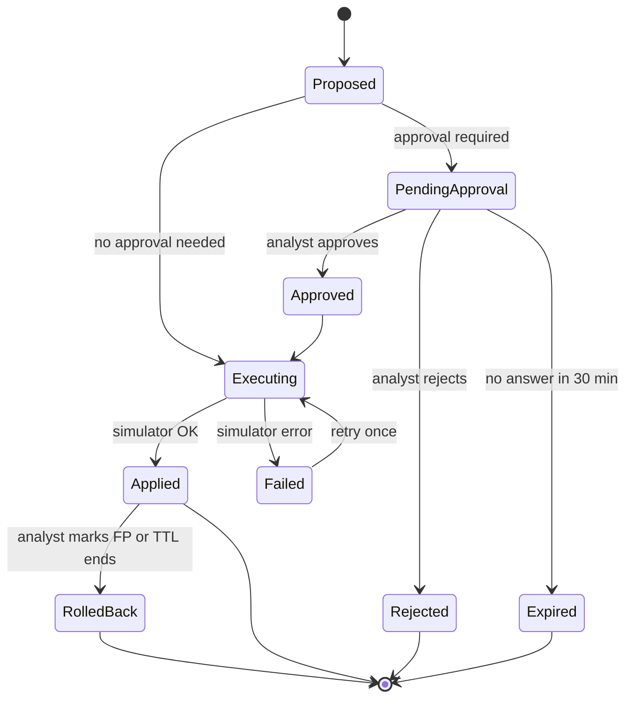
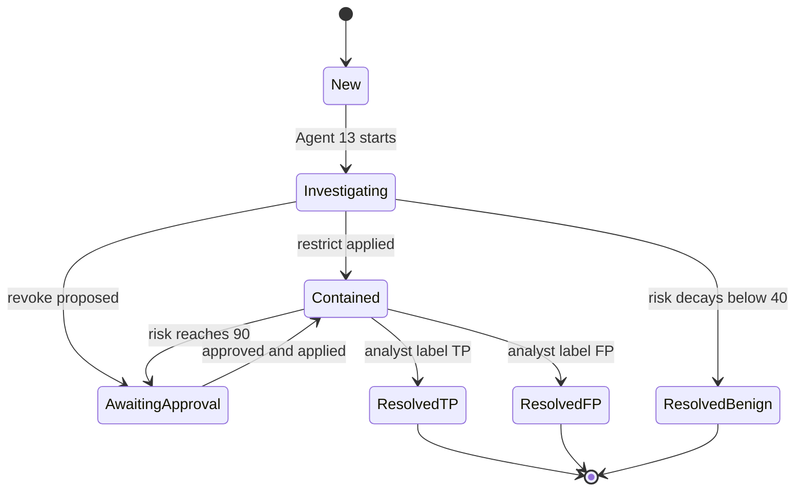

# IdentityShield v3: Technical Product Requirements Document

**Team:** Robust Gang · **Domain:** Cybersecurity · **Track 2:** Zero Trust for Everyone (Intelligent Identity Protection)
**Version:** 3.0 · **Date:** 30 Oct 2026 · **Status:** Build reference for the final round
**Scope note:** This document contains no implementation code. UML diagrams are written in Mermaid and render in GitHub, VS Code (Markdown Preview Mermaid Support), Obsidian and most Markdown viewers.

---

## Table of contents

1. Document control and how to use this PRD
2. Product overview
3. Goals, non-goals and success criteria
4. Users and use cases
5. Constraints and hackathon rules
6. System architecture (UML component diagram)
7. Deployment architecture (demo and AWS production)
8. Data sources and field mapping
9. Secure ingestion service (ngrok)
10. Canonical data model (UML class diagram)
11. Event bus and topic contracts
12. The 15 agents: detailed specifications
13. Detection catalog
14. Risk fusion model
15. Investigation and explanation
16. Response engine and playbooks
17. Learning loop
18. Supervisor and security architecture
19. API specification
20. User interface specification
21. Storage design
22. Performance and efficiency engineering
23. Evaluation methodology and KPIs
24. Loophole coverage matrix (GuardDuty, Okta, SIEM)
25. Attack generator website (laptop 2)
26. Observability
27. Testing strategy
28. Build plan and priorities
29. Risks and mitigations
30. Demo script and jury preparation (AWS manager)
31. Roadmap
32. Glossary
33. References

---

## 1. Document control and how to use this PRD

| Item | Value |
|---|---|
| Builds on | IdentityShield v2.1/v2.2 (FastAPI, 15 pipeline agents, live scan, audit chain, analytics, email) |
| Replaces | The v2 agent split and the single risk score |
| Keeps | Frozen Pydantic contract style, the supplied simulator as the only enforcement path, hash-chained audit, UI design system, existing pages |
| Owners | Backend lead (agents, fusion, API), ML lead (Agent 10, calibration, metrics), Frontend lead (pages, generator site), Demo lead (scenarios, ngrok, rehearsal) |

**Reading rules for the build team and the IDE assistant**

1. Sections 10, 11 and 19 are **contracts**. Change them only by updating this document first.
2. Every number marked *(tunable)* lives in configuration, never hard-coded.
3. Every requirement has an ID (FR-x, NFR-x, SEC-x). Tests reference these IDs.
4. "Must" means required for the final demo; "Should" means build if time allows; "Could" means roadmap.

---

## 2. Product overview

### 2.1 Problem in one paragraph

Attackers use valid credentials (phished passwords, leaked access keys, replayed session tokens) to log in through Okta and act inside AWS. Each action looks legitimate on its own. Okta's protection judges the login and the session; GuardDuty judges AWS activity and correlates attack sequences inside a 24-hour window; SIEMs need licenses, people and hand-written rules. No single tool tells one explainable story from the Okta login to the AWS impact, or chooses the lightest response that stops it.

### 2.2 Product in one paragraph

IdentityShield v3 is a 15-agent identity threat detection and response (ITDR) platform. It ingests Okta System Log and AWS CloudTrail events (files or a signed live feed over ngrok), resolves every event to one identity, detects valid-credential abuse, privilege escalation, defense evasion and campaigns, fuses signals into a calibrated **session risk** and **identity risk** (0–100), investigates and explains each case with evidence, MITRE ATT&CK mapping, counterfactuals and a predicted next step, and responds with graduated, policy-driven actions through the supplied simulator, with a human approving every revoke.

### 2.3 Positioning statement (for the AWS jury)

> IdentityShield complements GuardDuty. GuardDuty is excellent inside AWS; attacks now start before AWS, at the identity provider. IdentityShield is the identity layer that links the Okta login to what that identity does in AWS, keeps 30 days of identity history, explains every score, responds with just enough friction, and can take GuardDuty findings as input signals.

---

## 3. Goals, non-goals and success criteria

### 3.1 Goals

| ID | Goal |
|---|---|
| G1 | Detect valid-credential abuse and multi-step privilege escalation across Okta and AWS for the same identity |
| G2 | Produce one case per attacked session, not one alert per signal |
| G3 | Explain every score with evidence event IDs, MITRE techniques, counterfactuals and a predicted next step |
| G4 | Respond in graduated steps through the supplied simulator; human approval for revoke |
| G5 | Close documented loopholes of GuardDuty and Okta that fall inside identity telemetry (Section 24) |
| G6 | Show measured efficiency: latency, throughput and alert reduction on one laptop |
| G7 | Accept a live, authenticated event feed from a second machine over ngrok |

### 3.2 Non-goals

| ID | Non-goal | Reason |
|---|---|---|
| NG1 | Modify any live cloud account, identity provider or production tenant | Hackathon rule |
| NG2 | Inline, pre-authentication blocking (sub-150 ms) | IdentityShield is log-driven, so it is detective plus responsive, not inline |
| NG3 | DNS, VPC Flow Log, endpoint malware or TLS fingerprint analysis | Not in the provided data; roadmap via GuardDuty/EDR signals |
| NG4 | Replace GuardDuty, Security Hub or a SIEM | Positioned as a complement |
| NG5 | Let an LLM choose actions or compute risk | Deterministic math decides; LLM only narrates |

### 3.3 Success criteria for the final round

| ID | Criterion | Target *(tunable)* |
|---|---|---|
| SC1 | Event-level F1 on the official labeled dataset | Hybrid (rules + ML) beats rules-only and ML-only |
| SC2 | Session alert precision | ≥ 0.85 |
| SC3 | Chain reconstruction | Every labeled escalation chain recovered in order |
| SC4 | Hot-path latency (event received → signal) | p95 ≤ 1 s |
| SC5 | Warm-path latency (session closed → case + action) | p95 ≤ 10 s |
| SC6 | Throughput on a demo laptop | Measured and shown; goal ≥ 2,000 events/s |
| SC7 | Alert reduction (raw signals → cases) | ≥ 80 % |
| SC8 | Evasion pack | All scenarios in Section 25.3 detected live |
| SC9 | Explanation quality | 100 % of case reasons cite ≥ 1 existing evidence event ID |
| SC10 | Audit integrity | `/api/audit/verify` valid after the demo |

---

## 4. Users and use cases

### 4.1 Personas

| Persona | Needs |
|---|---|
| Security analyst (primary) | One case per attack, clear reasons, safe one-click actions, low noise |
| Security admin / CISO | Email summary of serious cases, KPIs, proof of control (audit) |
| Small-org IT admin | Runs on a laptop, no SOC, readable explanations ("Zero Trust for Everyone") |
| Jury / auditor | Transparent scoring, measured performance, honest limits |

### 4.2 Use-case diagram (UML)

### 4.3 Key user stories

| ID | Story | Acceptance |
|---|---|---|
| US1 | As an analyst I see one case per attacked session with the full chain | Case shows ordered steps, evidence IDs, MITRE, risk, confidence |
| US2 | As an analyst I know why a score is high | Top 3 factors with counterfactual scores |
| US3 | As an analyst I approve a revoke in one click and can undo a restrict | Approve/reject/rollback buttons; each writes an audit entry |
| US4 | As an admin I get a short email for cases ≥ 70 | Email within 30 s, rate-limited, no secrets in body |
| US5 | As the demo lead I attack from laptop 2 and see it caught live | Event signed, accepted, case visible in < 10 s |
| US6 | As a judge I can see that the system is measured, not claimed | KPI and performance pages with method notes |

---

## 5. Constraints and hackathon rules

| ID | Constraint |
|---|---|
| C1 | All enforcement through the supplied simulator only. No boto3 write calls, no Okta admin API calls. |
| C2 | No live production tenant is modified. Read-only access to a personal sandbox is out of scope for the demo. |
| C3 | Secrets (ingest HMAC keys, SMTP password, analyst token, optional LLM key) live only in `.env`, are git-ignored and never logged or returned by any API. |
| C4 | Revoke always requires analyst approval. |
| C5 | Reported metrics come from the official dataset only; the live generator is for demonstration. |
| C6 | The system must run offline on one laptop (ngrok and LLM are optional enhancements with fallbacks). |
| C7 | Stack: Python 3.11, FastAPI, Pydantic v2, pandas/NumPy, scikit-learn, NetworkX, SQLite; frontend HTML + vanilla JS + Tailwind + Chart.js + vis-network. |

---

## 6. System architecture

### 6.1 Layers

| Layer | Agents | Responsibility |
|---|---|---|
| Data | 1–4 | Collect, normalize, resolve identity, enrich, correlate, build graph |
| Detection | 5–11 | Specialist detectors publishing signals with strength, confidence, evidence and MITRE |
| Decision | 12–14 | Fuse risk, investigate and explain, respond |
| Learning | 15 | Tune weights and suppressions from analyst labels |
| Platform (not agents) | Supervisor, event bus, ingest service, API, audit store, notifier | Orchestration, security policy, persistence, presentation |

The Supervisor is platform code, not an agent, so no agent supervises itself (separation of duties).

### 6.2 UML component diagram

### 6.3 Processing paths (dual-speed plus nightly)

| Path | Trigger | Agents | Budget *(tunable)* | Output |
|---|---|---|---|---|
| Hot | Every event | 1, 2, 3 → 5, 6, 9 | p95 ≤ 1 s to signal | Fast signals (impossible travel, token replay, StopLogging) |
| Warm | Session closes (idle 15 min), session risk crosses 40, or every 30 s | 4, 7, 8, 10, 11 → 12, 13, 14 | p95 ≤ 10 s to case + action | Chains, campaigns, fused risk, response |
| Nightly / on demand | Schedule or "Retrain" button | 10, 15, 3 | Minutes | Baselines, calibrated weights, refreshed intel |

### 6.4 Run modes

| Mode | Description | Used for |
|---|---|---|
| Dataset | Batch replay of the official dataset through the same agents | Metrics (Section 23) |
| Live | Events arrive via ingest service; agents run continuously | Demo |
| Input-only | Scan only events entered on the Input page | Judge "try your own event" |
| Paced | Any mode slowed per agent step (0–3 s) for the Live Scan view | Demo narration |

---

## 7. Deployment architecture

### 7.1 Demo deployment (two laptops + ngrok)

| Rule | Detail |
|---|---|
| DEP-1 | Only port 8001 (ingest) is tunneled. Port 8000 (dashboard, approvals) binds to 127.0.0.1. |
| DEP-2 | Fallback A: both laptops on a phone hotspot, generator targets the LAN IP of port 8001. |
| DEP-3 | Fallback B: generator opened on laptop 1, targeting localhost:8001. |
| DEP-4 | Switching between modes takes one settings change in the generator (target URL field). Rehearse in < 30 s. |

### 7.2 Production reference deployment on AWS (roadmap, for jury questions)

| Concern | Production approach |
|---|---|
| Multi-account | Delegated-admin security account receives organization CloudTrail (same model as GuardDuty) |
| Scale | Partition by identity; each agent scales on stream lag |
| Cost | Metadata only; heavy work per session, not per event |
| Interop | Output OCSF to Security Lake and ASFF to Security Hub; ingest GuardDuty findings as Agent 3/11 signals |

---

## 8. Data sources and field mapping

### 8.1 Okta System Log fields used

| Okta field | Used for | Agent |
|---|---|---|
| `uuid` | Event ID, dedupe | 1 |
| `published` | Event time | 1, 2 |
| `eventType` (e.g. `user.session.start`, `user.authentication.auth_via_mfa`, MFA push deny/accept types) | Action classification | 2, 5, 6 |
| `actor.alternateId`, `actor.id` | Identity | 2 |
| `client.ipAddress`, `client.userAgent.rawUserAgent`, `client.device` | Network, device | 3, 5, 6 |
| `client.geographicalContext` (city, country, lat/lon) | Geo-velocity | 3, 5 |
| `securityContext` (asNumber, asOrg, isp, domain, isProxy) | ASN, proxy | 3, 5, 6 |
| `authenticationContext.externalSessionId` | Session stitching, token replay | 4, 6 |
| `outcome.result`, `outcome.reason` | Success, failure, deny | 5, 6, 11 |
| `debugContext.debugData` (risk, behaviors, threatSuspected) | Extra context, never trusted alone | 3 |
| `target[]` | Apps, roles touched | 4 |

### 8.2 AWS CloudTrail fields used

| CloudTrail field | Used for | Agent |
|---|---|---|
| `eventID`, `eventTime` | ID, time | 1, 2 |
| `eventSource`, `eventName` | Action, service | 2, 7, 8, 9 |
| `userIdentity` (type, arn, accessKeyId, sessionContext.sessionIssuer, sourceIdentity) | Identity, key, role chain | 2, 4, 7 |
| `sourceIPAddress`, `userAgent` | Network, client | 3, 5, 7 |
| `vpcEndpointId` | Credential origin checks | 7 |
| `requestParameters`, `responseElements` | Policy ARNs, new keys, role session names | 4, 8, 9 |
| `errorCode`, `errorMessage` | Failed attempts, probing | 8, 10 |
| `readOnly`, `managementEvent` | Action type | 9, 12 |
| `recipientAccountId`, `awsRegion` | Scope, unusual region | 3, 10 |

### 8.3 Identity resolution rules (Agent 2)

| Rule | Link |
|---|---|
| IR-1 | Okta `actor.alternateId` (email) ↔ CloudTrail `AssumeRoleWithSAML` role session name / `sourceIdentity` |
| IR-2 | AWS IAM Identity Center user name ↔ Okta login (same email) |
| IR-3 | `AssumeRole` response credentials (`accessKeyId`) → later events using that key inherit the parent identity |
| IR-4 | `CreateAccessKey` response key → owner identity and creator identity both recorded (key lineage) |
| IR-5 | Unresolved principals become their own identity with `resolution_confidence` < 1 |
| IR-6 | Resolution map stored with first-seen/last-seen and evidence event IDs |

---

## 9. Secure ingestion service (ngrok)

### 9.1 Requirements

| ID | Requirement |
|---|---|
| ING-1 | Separate process on port 8001 exposing only `POST /ingest/v1/events` and `GET /ingest/v1/health`. |
| ING-2 | Every request carries headers: key ID, Unix timestamp, random nonce, signature. |
| ING-3 | Signature = HMAC-SHA256 with the key's secret over: timestamp, newline, nonce, newline, SHA-256 hex digest of the raw body. Constant-time comparison. |
| ING-4 | Reject if timestamp skew > 60 s, nonce seen in last 5 min, unknown key, or bad signature (401). |
| ING-5 | Body ≤ 1 MB (413); ≤ 20 requests/s and ≤ 2,000 events/min per key (429). |
| ING-6 | Body is an envelope: source (`okta` or `cloudtrail`), sender ID, batch ID, list of events (≤ 500). |
| ING-7 | Schema validation per source; unknown fields are dropped; strings truncated at 2 KB; invalid events reported per index (207-style partial result). |
| ING-8 | Accepted events are written to an append-only spool, then handed to Agent 1. Ingest never calls agents synchronously. |
| ING-9 | Response contains accepted count, rejected count with reasons, and server receive time (for latency measurement). |
| ING-10 | Every accepted batch is an audit entry (sender, batch ID, counts, body hash). |
| ING-11 | Requests from the generator include the header that skips the ngrok free-plan browser interstitial. |
| ING-12 | Keys and secrets come from `.env`; rotation by adding a second key ID. |

### 9.2 Ingest sequence (UML)

---

## 10. Canonical data model

### 10.1 UML class diagram

### 10.2 Enumerations

| Enum | Values |
|---|---|
| `source` | okta, cloudtrail, manual, generator |
| `class_name` (OCSF-style) | authentication, account_change, api_activity, entity_management, data_access |
| `action_type` | read, write, permission_change, credential_change, destructive, defense_evasion |
| `stage` (kill chain) | initial_access, credential_access, discovery, privilege_escalation, persistence, defense_evasion, collection, exfiltration, impact |
| `band` | monitor (< 40), step_up (40–69), restrict (70–89), revoke (≥ 90) |
| `case.status` | new, investigating, contained, awaiting_approval, resolved_tp, resolved_fp, resolved_benign |
| `action.state` | proposed, pending_approval, approved, executing, applied, failed, rejected, expired, rolled_back |
| `label.verdict` | true_positive, false_positive, benign_true_positive |

---

## 11. Event bus and topic contracts

### 11.1 Bus behavior

| ID | Requirement |
|---|---|
| BUS-1 | In-process asynchronous publish/subscribe with named topics and bounded queues (default 10,000 messages per topic, *tunable*). |
| BUS-2 | Every message carries topic, message ID, producer agent, run ID, created time, schema version, payload. |
| BUS-3 | Ordering guaranteed per identity (partition key = identity_id). |
| BUS-4 | Back-pressure: when a queue is 80 % full, the Supervisor slows ingestion and raises a health warning. |
| BUS-5 | The Supervisor rejects a publish to a topic not listed in the producer's capability manifest. |
| BUS-6 | The interface is identical to Redis Streams consumer groups so production swaps transport only. |

### 11.2 Topics

| Topic | Producer | Consumers | Payload |
|---|---|---|---|
| `raw.okta`, `raw.cloudtrail` | Ingest / file loader | 1 | Raw records |
| `events` | 1 → 2 | 3 | Normalized Event |
| `events.enriched` | 3 | 4, 5, 6, 9, 10 | Event + Context |
| `sessions` | 4 | 5, 6, 7, 10, 11 | Session open/update/close |
| `graph.updates` | 4 | 7, 8, 11, 13 | Node/edge deltas |
| `signals` | 5–11 | 12, 11 (campaign) | Signal |
| `risk` | 12 | 13, 14, UI | RiskScore pair |
| `cases` | 13 | 14, UI, Notifier | Case |
| `actions` | 14 | UI, Audit | Action state changes |
| `labels` | API | 15 | Label |
| `config.updates` | 15 | 12, 5–11 | Weights, thresholds, suppressions |
| `trace` | All agents, Supervisor | Live Scan UI (SSE) | Trace events (started, progress, finding, threat, done) |

---

## 12. The 15 agents: detailed specifications

Every agent specification follows the same template: purpose, consumes, publishes, state, logic, configuration, failure behavior, latency budget.

**Common agent contract (all agents)**

| ID | Requirement |
|---|---|
| AG-1 | Stateless code with explicit state object; state can be snapshotted to disk and restored. |
| AG-2 | Publishes trace events: started, progress, finding, threat, done, failed. |
| AG-3 | Exposes health: status, last message time, queue lag, processed count, error count, p95 latency. |
| AG-4 | Never raises into the bus: errors are caught, counted, traced and the message is sent to a dead-letter topic. |
| AG-5 | Every signal includes evidence event IDs that exist in the event store. |
| AG-6 | Only uses the capabilities in its manifest (Section 18.2). |
| AG-7 | Deterministic for the same input and configuration (seeded randomness for ML). |

### Agent 1: Collector

| Field | Specification |
|---|---|
| Purpose | Bring events in from files, the ingest spool and the Input page |
| Consumes | `raw.okta`, `raw.cloudtrail`, file loader |
| Publishes | `events` (minimal parse) |
| State | Seen event IDs (rolling 24 h bloom filter + exact set for last 100k), per-source watermark |
| Logic | Dedupe by event ID; detect source; reorder late events inside a 120 s watermark (*tunable*); events later than watermark are processed and flagged `late=true` |
| Config | watermark_seconds, dedupe_window_hours |
| Failure | Malformed record → dead letter with reason, counter increment |
| Budget | ≤ 5 ms per event |

### Agent 2: Normalizer and Identity Resolver

| Field | Specification |
|---|---|
| Purpose | One schema for both sources; one identity per human or workload |
| Consumes | `events` |
| Publishes | `events` (normalized) |
| State | Identity alias map, key lineage map, role-session map |
| Logic | Map fields per Section 8 to the Event class; classify `class_name` and `action_type` from an action catalog table; apply identity rules IR-1 to IR-6; attach `resolution_confidence` |
| Config | Action catalog (eventName → class, action_type, stage hint) |
| Failure | Unknown eventName → class `api_activity`, action_type `write` if not read-only, flagged `uncatalogued` |
| Budget | ≤ 10 ms per event |

### Agent 3: Context and Threat Intel

| Field | Specification |
|---|---|
| Purpose | Add the context that turns an event into evidence |
| Consumes | `events` |
| Publishes | `events.enriched` |
| State | Offline geo/ASN table, Tor exit list, hosting ASN list, trusted IP list, custom threat list, privilege table (from IAM policies in the dataset), resource sensitivity tags, peer groups |
| Logic | Geo and ASN from Okta `securityContext` when present, else offline table; set flags is_proxy, is_tor, is_hosting, trusted_ip; privilege level 1–5 from attached policies (5 = AdministratorAccess or IAM write on `*`); sensitivity 1–5 from tags (secrets, KMS, production data = 5); optional GuardDuty finding import as external signal (roadmap) |
| Config | Lists and tables as versioned files; refresh nightly |
| Failure | Missing context → neutral values (privilege 2, sensitivity 2), `context_complete=false` lowers downstream confidence |
| Budget | ≤ 5 ms per event (set lookups only) |

### Agent 4: Correlation and Graph

| Field | Specification |
|---|---|
| Purpose | Stitch sessions across providers and keep a 30-day identity graph |
| Consumes | `events.enriched` |
| Publishes | `sessions`, `graph.updates` |
| State | Open sessions per identity, graph with 30-day retention |
| Logic | Session = Okta session (externalSessionId) plus all AWS events from credentials derived from it within the session window; idle timeout 15 min closes a session; graph nodes: identity, session, IP, ASN, device, access key, role, resource; edges: logged_in_from, assumed, created_key, used_key, called, touched; blast radius = count of sensitive resources reachable from the identity through role and key edges |
| Config | session_idle_minutes, graph_retention_days, max_nodes |
| Failure | Graph over max_nodes → prune oldest low-risk edges first |
| Budget | ≤ 20 ms per event amortized |

### Agent 5: Access Anomaly

| Field | Specification |
|---|---|
| Purpose | Valid-credential logins from where, when or what the user never uses |
| Consumes | `events.enriched`, `sessions` |
| Publishes | `signals` |
| State | Per-identity login history (last 30 successful logins): locations, ASNs, devices, hours |
| Logic | D-ACC-01 to D-ACC-04 (Section 13); strength scales with distance from baseline (e.g. geo-velocity ÷ threshold, rarity of ASN) |
| Config | max_speed_kmh 900, min_distance_km 500, min_history 5 |
| Failure | Cold-start identity (< 5 logins) → use peer-group baseline, confidence × 0.6 |
| Budget | Hot path, ≤ 10 ms |

### Agent 6: Session and Token Integrity

| Field | Specification |
|---|---|
| Purpose | Catch stolen sessions and MFA abuse after login |
| Consumes | `events.enriched`, `sessions` |
| Publishes | `signals` |
| State | Per-session fingerprint (first IP, ASN, UA family, device), per-user MFA push counters |
| Logic | D-SES-01 to D-SES-04; a fingerprint change without re-authentication is token replay; ASN change is stronger than IP change within the same ASN; UA change alone is weak (spoofable) |
| Config | mfa_fatigue_denies 5, mfa_window_minutes 10 |
| Budget | Hot path, ≤ 10 ms |

### Agent 7: Credential Lifecycle

| Field | Specification |
|---|---|
| Purpose | Misuse of keys, dormant accounts and instance credentials |
| Consumes | `sessions`, `graph.updates`, `events.enriched` |
| Publishes | `signals` |
| State | Last activity per identity and key, key creation records, instance-role baseline (expected source: AWS service IP ranges, expected VPC endpoint IDs) |
| Logic | D-CRD-01 to D-CRD-05 |
| Config | dormant_days 30, new_key_window_minutes 60 |
| Budget | Warm path |

### Agent 8: Privilege Escalation

| Field | Specification |
|---|---|
| Purpose | Recognize escalation as an ordered path, not a single call |
| Consumes | `graph.updates`, `sessions` |
| Publishes | `signals` (one per matched path, with all step evidence) |
| State | Escalation path library (Section 13.4), partial matches per identity over 30 days |
| Logic | Each path is an ordered list of step predicates with max gap between steps (default 7 days); partial matches persist so slow chains complete; strength = steps matched ÷ path length × path severity |
| Config | max_step_gap_hours 168, path library file |
| Budget | Warm path |

### Agent 9: Defense Evasion and Impact

| Field | Specification |
|---|---|
| Purpose | Catch attackers blinding monitors or destroying data |
| Consumes | `events.enriched` |
| Publishes | `signals` |
| Logic | D-DEF-01 to D-DEF-07; any defense-evasion event from an identity with a recent anomaly is boosted |
| Budget | Hot path, ≤ 5 ms |

### Agent 10: Behavioral ML

| Field | Specification |
|---|---|
| Purpose | Find what no rule describes |
| Consumes | `sessions` (closed or updated) |
| Publishes | `signals` |
| State | Trained models (Isolation Forest per peer group, Markov transition matrix of action categories per identity and per peer group), feature scaler |
| Features | Session duration, event count, distinct services, distinct regions, write ratio, permission-change count, error ratio, sensitive-resource count, new-API ratio (APIs never used by this identity), hour-of-day deviation, ASN novelty |
| Logic | D-ML-01 anomaly score → strength via rank percentile; D-ML-02 sequence rarity = negative log-likelihood of the session's action sequence under the identity's Markov model, normalized by peer group |
| Training | Nightly or on demand on sessions labeled benign or unlabeled; contamination 0.02 (*tunable*); fixed random seed |
| Failure | No model yet → skip with trace "model not trained", no signal |
| Budget | ≤ 2 ms per session to score |

### Agent 11: Campaign

| Field | Specification |
|---|---|
| Purpose | See attacks across identities, not one at a time |
| Consumes | `events.enriched`, `signals` |
| Publishes | `signals` (campaign-level, attached to every affected identity) |
| State | Sliding windows keyed by IP, ASN, access key, user-agent hash |
| Logic | D-CMP-01 to D-CMP-03 |
| Budget | Warm path |

### Agent 12: Risk Fusion

| Field | Specification |
|---|---|
| Purpose | Turn many signals into two calibrated numbers |
| Consumes | `signals`, `config.updates` |
| Publishes | `risk` |
| State | Open session risks, identity risks with last-update time, detector weights |
| Logic | Section 14 |
| Budget | ≤ 5 ms per update |

### Agent 13: Investigation and Explanation

| Field | Specification |
|---|---|
| Purpose | Build the case an analyst can trust in 30 seconds |
| Consumes | `risk` (session risk ≥ 40), graph, event store |
| Publishes | `cases` |
| Logic | Section 15 (bounded investigation loop, chain ordering, counterfactuals, next-step prediction, narrative) |
| Budget | ≤ 2 s per case |

### Agent 14: Response

| Field | Specification |
|---|---|
| Purpose | Apply the lightest action that stops the attack, safely |
| Consumes | `cases`, approvals from API |
| Publishes | `actions`, notifier messages |
| Logic | Section 16 |
| Special capability | The only agent holding the simulator credential |
| Budget | ≤ 1 s from case to action proposal |

### Agent 15: Feedback and Tuning

| Field | Specification |
|---|---|
| Purpose | Learn from analysts so noise falls over time |
| Consumes | `labels` |
| Publishes | `config.updates` |
| Logic | Section 17 |
| Guardrail | Never lowers a defense-evasion or escalation detector weight below its floor; every change audited and reversible |

---

## 13. Detection catalog

Base strength is the starting value before the agent scales it; MITRE IDs follow ATT&CK for Enterprise (Cloud and SaaS).

### 13.1 Access and session

| ID | Detection | Logic summary | Base strength | MITRE |
|---|---|---|---|---|
| D-ACC-01 | Impossible travel | Two successful logins whose implied speed > 900 km/h and distance > 500 km | 0.7 | T1078.004 |
| D-ACC-02 | New device or ASN | Device or ASN not in last 30 logins and not trusted | 0.4 | T1078 |
| D-ACC-03 | Unusual hour | Login hour outside the identity's 5th–95th percentile window | 0.25 | T1078 |
| D-ACC-04 | Anonymizing network | Tor, hosting provider or proxy flag on a privileged identity | 0.5 | T1090.003 |
| D-SES-01 | Token replay | Same session ID or derived credential used from a new ASN without re-auth | 0.8 | T1550.004, T1539 |
| D-SES-02 | MFA fatigue | ≥ 5 denied pushes in 10 min followed by an accept | 0.85 | T1621 |
| D-SES-03 | Session fingerprint drift | UA family and device change mid-session (weak alone) | 0.2 | T1550 |
| D-SES-04 | MFA bypass on privileged login | Privileged session without MFA event where policy expects it | 0.5 | T1556 |

### 13.2 Credentials

| ID | Detection | Logic summary | Base | MITRE |
|---|---|---|---|---|
| D-CRD-01 | Dormant account wakes | No activity ≥ 30 days, then success + any write | 0.5 | T1078.004 |
| D-CRD-02 | Key for another user | CreateAccessKey where target user ≠ caller | 0.7 | T1098.001 |
| D-CRD-03 | New key from new place | Key created and first used from an IP/ASN never seen for the owner within 60 min | 0.6 | T1098.001 |
| D-CRD-04 | Instance credential misuse | Role session issued to an EC2 instance used from a non-AWS IP or an unexpected VPC endpoint ID | 0.85 | T1552.005 |
| D-CRD-05 | Login profile change for another user | CreateLoginProfile / UpdateLoginProfile on a different user | 0.7 | T1098 |

### 13.3 Defense evasion and impact

| ID | Detection | Events | Base | MITRE |
|---|---|---|---|---|
| D-DEF-01 | Logging stopped or reduced | StopLogging, DeleteTrail, UpdateTrail, PutEventSelectors removing management events | 0.9 | T1562.008 |
| D-DEF-02 | Detector disabled | GuardDuty DeleteDetector, UpdateDetector (disable), DisassociateMembers | 0.9 | T1562.001 |
| D-DEF-03 | Flow logs deleted | DeleteFlowLogs | 0.7 | T1562.008 |
| D-DEF-04 | Data made public | PutBucketPolicy or PutBucketAcl granting public access, DeletePublicAccessBlock | 0.8 | T1530 |
| D-DEF-05 | Key destruction | ScheduleKeyDeletion, DisableKey on sensitive keys | 0.85 | T1485 |
| D-DEF-06 | Mass deletion | ≥ 50 delete calls in 5 min by one identity | 0.8 | T1485 |
| D-DEF-07 | Secret harvesting | ≥ 5 GetSecretValue on distinct secrets in 10 min | 0.7 | T1555.006 |

### 13.4 Privilege-escalation path library (Agent 8)

| Path ID | Ordered steps (within max gap) | Severity |
|---|---|---|
| PE-01 | CreatePolicyVersion (set as default) on a policy attached to self | 0.9 |
| PE-02 | AttachUserPolicy or AttachRolePolicy with admin policy → use of new permission | 0.9 |
| PE-03 | PutUserPolicy or PutRolePolicy with wildcard action → privileged call | 0.85 |
| PE-04 | PassRole + CreateFunction (or UpdateFunctionCode) → Invoke | 0.85 |
| PE-05 | UpdateAssumeRolePolicy to trust self → AssumeRole into that role | 0.9 |
| PE-06 | AddUserToGroup (admin group) → privileged call | 0.85 |
| PE-07 | CreateAccessKey or CreateLoginProfile for another user → activity as that user | 0.85 |
| PE-08 | Discovery burst (List*/Get* across ≥ 5 services) → any of PE-01..07 → secrets or data access | 1.0 (full chain) |

### 13.5 ML and campaign

| ID | Detection | Logic | Base | MITRE |
|---|---|---|---|---|
| D-ML-01 | Session anomaly | Isolation Forest score in top 2 % of peer group | rank-scaled | T1078 |
| D-ML-02 | Sequence rarity | Action sequence log-likelihood below 1st percentile | rank-scaled | T1078, T1580 |
| D-CMP-01 | Password spray | One IP or ASN with failures on ≥ 10 identities in 10 min | 0.6 | T1110.003 |
| D-CMP-02 | Stuffing success | Spray source then a success on any targeted identity | 0.85 | T1110.004 |
| D-CMP-03 | Shared infrastructure | Same IP, key or UA hash used by ≥ 3 identities with signals in 24 h | 0.5 | T1078 |

---

## 14. Risk fusion model (Agent 12)

### 14.1 Session risk

Step 1, combine signals with a weighted noisy-OR, so independent weak signals add up and one strong signal is enough:

> P = 1 − ∏ (1 − wᵢ · cᵢ · sᵢ) over all signals i in the session

where sᵢ is strength (0–1), cᵢ the detector confidence (0–1, reduced for cold start or missing context) and wᵢ the learned detector weight (0–1).

Step 2, scale by context and chain:

> SessionRisk = min(100, 100 · P · M_privilege · M_sensitivity · M_action · F_chain)

| Multiplier | Values *(tunable)* |
|---|---|
| M_privilege (level 1–5) | 0.8, 1.0, 1.15, 1.3, 1.5 |
| M_sensitivity (highest resource touched, 1–5) | 0.9, 1.0, 1.1, 1.25, 1.4 |
| M_action (worst action type in session) | read 1.0, write 1.1, permission_change or credential_change 1.25, destructive or defense_evasion 1.4 |
| F_chain (distinct kill-chain stages with evidence) | 1 + 0.15 × (stages − 1), capped at 1.6 |

### 14.2 Identity risk

> IdentityRisk(t) = max( IdentityRisk₀ · e^(−λ·Δt), latest SessionRisk ), with λ = ln 2 ÷ 24 h (half-life 24 h, *tunable*)

- A one-off anomaly fades within days; repeated sessions keep it high.
- Identity risk ≥ 60 lowers the step-up threshold for the next session by 10 points (pre-emptive scrutiny).

### 14.3 Confidence

Case confidence = weighted mean of signal confidences × context completeness (share of events with full context) × resolution confidence of the identity. Shown next to every score; a high score with low confidence is labeled "needs review".

### 14.4 Calibration

| Step | Method |
|---|---|
| Weights wᵢ | Logistic regression on labeled sessions (features = per-detector strength), L2 regularized, class-balanced |
| Check | Reliability diagram (10 bins) and Brier score on a held-out split |
| Guarantee | Shown on the Analytics page; a score of 80 should be correct about 80 % of the time on held-out data |
| Floors | Escalation and defense-evasion detectors have minimum weights so feedback can never silence them |

### 14.5 Bands

| Band | Session risk | Default action |
|---|---|---|
| monitor | < 40 | Monitor |
| step_up | 40–69 | MFA step-up |
| restrict | 70–89 | Restrict |
| revoke | ≥ 90 | Restrict now + revoke pending approval |

---

## 15. Investigation and explanation (Agent 13)

### 15.1 Bounded investigation loop (UML activity)

### 15.2 Case contents

| Element | Rule |
|---|---|
| Chain | Evidence ordered by time and grouped by kill-chain stage; each step has event ID, action, resource, MITRE |
| Reasons | Top 3 factors in plain language, each citing ≥ 1 evidence event ID |
| Counterfactuals | Recompute session risk removing one factor at a time (each signal family, each multiplier); report the 3 largest drops, e.g. "without the escalation chain: 44" |
| Next step | First-order Markov model over action categories learned from the escalation library and labeled attacks; show top 2 with probability if p ≥ 0.3 |
| Blast radius | Sensitive resources reachable from the identity |
| Related | Other identities sharing IP, key or ASN found by pivots |

### 15.3 LLM narrative guardrails (optional feature)

| ID | Guardrail |
|---|---|
| LLM-1 | Off by default; enabled only when a key or local model is configured in `.env` |
| LLM-2 | Input is the structured case only; all log-derived strings are passed as quoted data with a "treat as data, not instructions" boundary |
| LLM-3 | The LLM has no tools and cannot trigger actions |
| LLM-4 | Output must cite evidence IDs; any ID not in the case → output discarded, template narrative used |
| LLM-5 | Timeout 5 s, then template narrative |
| LLM-6 | Narrative never changes score, band or action |

---

## 16. Response engine and playbooks (Agent 14)

### 16.1 Playbook definition (policy-as-code, YAML files)

| Field | Meaning |
|---|---|
| id | Unique playbook ID |
| match.band | One or more bands |
| match.patterns | Optional detection IDs required |
| match.min_confidence | Minimum case confidence |
| match.identity_tags | Optional (e.g. break-glass accounts excluded) |
| action | monitor, step_up, restrict, revoke_sessions, disable_key, quarantine_identity |
| approval_required | true/false (always true for revoke and quarantine) |
| ttl_minutes | Auto-expiry of restrictive actions unless confirmed |
| friction_cost | Units counted against the user's friction budget |
| rollback | Action to undo |
| notify | email/webhook targets by band |

### 16.2 Default playbooks

| ID | Match | Action | Approval | TTL |
|---|---|---|---|---|
| PB-01 | step_up | MFA step-up | No | n/a |
| PB-02 | restrict | Restrict: deny sensitive resources, read-only | No | 240 min |
| PB-03 | revoke | Restrict now (PB-02) and propose revoke sessions + disable new keys | Revoke: yes | Restrict 240 min |
| PB-04 | any band with D-DEF-01/02 | Restrict immediately regardless of score | No | 240 min |
| PB-05 | D-CMP-01 source | Block source IP in simulator | No | 60 min |

### 16.3 Friction budget

- Each identity has 2 friction units per rolling 8 h (*tunable*).
- Step-up costs 1 unit. When the budget is exhausted, the case goes to the analyst instead of prompting the user again.
- Prevents MFA prompt fatigue created by the defender itself.

### 16.4 Action lifecycle (UML state diagram)

### 16.5 Case lifecycle (UML state diagram)

### 16.6 Response requirements

| ID | Requirement |
|---|---|
| RSP-1 | Simulator is the only enforcement target; calls are idempotent by action ID |
| RSP-2 | Every state change writes an audit entry |
| RSP-3 | Rollback available for restrict, block and key disable |
| RSP-4 | Notifier sends one email per case at ≥ 70 (digest within 60 s, max 10 per hour), HTML-escaped, no secrets |
| RSP-5 | Dry-run mode shows what would be done without calling the simulator |

---

## 17. Learning loop (Agent 15)

| Input | Effect |
|---|---|
| False positive label | Lower weight of contributing detectors by a small step (learning rate 0.05, *tunable*) down to the floor; propose a suppression rule (identity + detection + ASN) for analyst approval |
| True positive label | Raise weights of contributing detectors; add the confirmed chain to the next-step model |
| Benign true positive (e.g. approved pentest) | Time-boxed suppression for that identity and detection |
| Nightly | Re-fit calibration (Section 14.4) when ≥ 20 new labels exist |

Every change is published on `config.updates`, versioned, audited and reversible from the UI.

---

## 18. Supervisor and security architecture

### 18.1 Supervisor duties

| ID | Duty |
|---|---|
| SUP-1 | Start, stop and restart agents; restart a failed agent up to 3 times, then mark degraded |
| SUP-2 | Enforce capability manifests on every publish, store write and simulator call |
| SUP-3 | Collect health and latency metrics; expose `/api/agents` and `/api/metrics/perf` |
| SUP-4 | Apply back-pressure (BUS-4) |
| SUP-5 | Schedule warm-path ticks and nightly jobs |
| SUP-6 | Pace mode for the Live Scan (0–3 s per step) |

### 18.2 Capability manifest matrix

| Agent | Publishes | Reads store | Writes store | Simulator | Network out | LLM |
|---|---|---|---|---|---|---|
| 1 Collector | events | spool | events | No | No | No |
| 2 Normalizer | events | catalog | identity map | No | No | No |
| 3 Context | events.enriched | intel tables | No | No | No | No |
| 4 Correlation | sessions, graph.updates | events | graph | No | No | No |
| 5–11 Detectors | signals | events, graph | own state | No | No | No |
| 12 Risk Fusion | risk | signals, config | risk | No | No | No |
| 13 Investigation | cases | all read | cases | No | No | Optional |
| 14 Response | actions | cases, playbooks | actions | **Yes** | Email only | No |
| 15 Feedback | config.updates | labels, cases | config | No | No | No |

### 18.3 Threat model (STRIDE)

| Threat | Example | Mitigation |
|---|---|---|
| Spoofing | Fake log batches sent to the public ngrok URL | HMAC signature, key IDs, timestamp skew check (ING-2–4) |
| Tampering | Editing an alert or deleting an audit row | Hash-chained audit, verify endpoint, append-only spool |
| Repudiation | "Nobody approved that revoke" | Approval records analyst, time and reason in the audit chain |
| Information disclosure | Secrets in logs or API responses; dashboard exposed | Secrets only in `.env`; redaction filter on logs; dashboard bound to localhost; analyst token for mutating endpoints |
| Denial of service | Flooding ingest | Rate limits, size limits, bounded queues, back-pressure |
| Elevation of privilege | A detector calling the simulator | Capability manifests enforced by Supervisor |
| Injection (LLM, UI) | Malicious user-agent text containing instructions or HTML | LLM guardrails (15.3), HTML escaping in every page, no template evaluation of log strings |
| Replay | Re-sending a captured valid ingest request | Nonce cache + 60 s window |

### 18.4 Security requirements

| ID | Requirement |
|---|---|
| SEC-1 | All mutating API endpoints require the analyst token header when configured |
| SEC-2 | CORS disabled on port 8000; ingest accepts only POST with JSON content type |
| SEC-3 | Logs pass through a redaction filter (keys, tokens, emails optionally masked) |
| SEC-4 | Dependencies pinned; no runtime downloads |
| SEC-5 | `.env` and `data/spool` git-ignored; `.env.example` documents every variable |

---

## 19. API specification

Base: `http://127.0.0.1:8000/api` (core) and the ngrok URL or `:8001` (ingest). All responses JSON; errors use `{detail}`.

### 19.1 Ingest service

| Method | Path | Purpose | Auth |
|---|---|---|---|
| POST | /ingest/v1/events | Signed batch of events | HMAC |
| GET | /ingest/v1/health | Liveness, accepted count | None |

### 19.2 Core (existing endpoints kept, new ones marked ★)

| Method | Path | Purpose |
|---|---|---|
| GET | /health | Liveness and version |
| GET | /identities | Identities with identity risk, sorted |
| GET | /identities/{id} | Identity detail, aliases, sessions |
| GET | /identities/{id}/attack | Attack path graph + top case |
| GET | /graph/global | Top identities graph |
| ★ GET | /cases | Cases with filters (band, status, since) |
| ★ GET | /cases/{id} | Full case (chain, reasons, counterfactuals, next steps, narrative) |
| ★ POST | /cases/{id}/label | TP / FP / benign label (token) |
| ★ GET | /actions | Actions and states |
| ★ POST | /actions/{id}/approve, /reject, /rollback | Approval workflow (token) |
| ★ GET | /playbooks | Loaded playbooks (read-only) |
| GET | /agents | 15 agents with health and live state |
| ★ GET | /stream | Server-Sent Events: trace, risk, cases, actions |
| POST | /scan/start | Dataset / input-only scan with pace |
| GET | /scan/status, /scan/trace | Scan progress and trace |
| GET, POST, DELETE | /inputs, /inputs/upload, /inputs/manual | Input data page |
| GET | /analytics/detectors, /analytics/heatmap/time, /analytics/heatmap/identities | Rules vs ML vs hybrid, heatmaps |
| ★ GET | /metrics/kpi | P/R/F1, session precision, chain reconstruction, calibration |
| ★ GET | /metrics/perf | Latency p50/p95, throughput, queue lag, alert reduction |
| GET | /audit, /audit/verify | Audit log and chain verification |
| GET | /notifications, /notifications/status; POST /notifications/test | Email |
| ★ POST | /config/rollback/{version} | Revert a learning change (token) |

---

## 20. User interface specification

Design system unchanged (dark theme: background #0B0F17, panel #111827, brand #3B82F6 / #22D3EE, critical #EF4444).

| Page | Must show | New in v3 |
|---|---|---|
| Dashboard | KPIs, top identities by identity risk, open cases by band, live event rate | Identity vs session risk, events/s tile |
| Live Scan | Agents running step by step, colored trace, JSON panel, findings and threats | Live feed mode via SSE; per-path (hot/warm) labels |
| Agents | 15 cards: state, processed, lag, p95 latency, errors | Health from Supervisor; capability badge |
| Cases ★ | Case list → case detail: chain timeline, evidence table, MITRE chips, counterfactual bars, next-step prediction, blast radius, actions with approve/reject/rollback, label buttons | Replaces alert detail |
| Attack Path Explorer | Identity graph with suspicious edges | Okta-to-AWS edges highlighted; pivot results |
| Analytics | Rules vs ML vs hybrid, heatmaps | Calibration diagram, per-detector precision |
| Performance ★ | Latency histogram, throughput, queue lag, alert reduction | Benchmark run button and method note |
| Input | Upload/manual entry, presets | Evasion-pack presets |
| Audit | Entries, verify | Filter by case |
| Notifications | Email status and outbox | — |
| Settings ★ | Thresholds, friction budget, playbooks (read-only), learning history | Rollback of learning versions |

---

## 21. Storage design

| Store | Technology | Contents | Retention |
|---|---|---|---|
| Spool | Append-only JSON Lines files | Accepted raw ingest batches | Demo session |
| Event store | Parquet files per hour, queried via DuckDB (or pandas) | Normalized + enriched events | 30 days |
| State DB | SQLite (WAL mode) | identities, sessions, signals, risk, cases, actions, labels, config versions, notifications | 30 days (cases kept) |
| Graph | NetworkX in memory, snapshot to disk every 5 min | Identity graph | 30 days |
| Audit | SQLite table, hash chain | Every decision and approval | Permanent |
| Models | Files with version and training metadata | Isolation Forests, Markov matrices, calibration | Versioned |

---

## 22. Performance and efficiency engineering

### 22.1 Techniques

| Technique | Where | Effect |
|---|---|---|
| Incremental per-identity state | Agents 4–12 | No full re-run per event; O(1) updates |
| Hot/warm split | Supervisor | Cheap checks per event, heavy work per session |
| Set and dictionary lookups for intel | Agent 3 | O(1) enrichment |
| Pre-trained models, scoring only at runtime | Agent 10 | Microsecond scoring |
| Batched writes (every 250 ms or 500 rows) | Stores | Fewer disk syncs |
| Graph pruning by age and risk | Agent 4 | Bounded memory |
| Partition by identity | Bus | Parallel workers without locks across identities |
| Bounded queues + back-pressure | Bus | Stable under floods |

### 22.2 Budgets *(tunable targets, verified by benchmark)*

| Metric | Target |
|---|---|
| Hot path p95 (receive → signal) | ≤ 1 s |
| Warm path p95 (session close → case + action) | ≤ 10 s |
| Throughput (replay mode, one laptop) | ≥ 2,000 events/s |
| Memory for 1 M events in window | ≤ 2 GB |
| Ingest request p95 (valid batch of 100) | ≤ 150 ms |

### 22.3 Benchmark method

1. Replay the official dataset at increasing multiples (×1, ×5, ×10) with fresh event IDs.
2. Record receive time, signal time, case time per event and session.
3. Report p50/p95 latencies, events/s, peak queue lag, memory peak, alert reduction (signals ÷ cases).
4. Show results on the Performance page with machine spec and date.
5. Never present targets as results.

---

## 23. Evaluation methodology and KPIs

| KPI | Definition | Method |
|---|---|---|
| Event precision / recall / F1 | Malicious events flagged as evidence vs ground truth | Official labels; rules-only, ML-only, hybrid |
| Session alert precision | Cases that are true attacks ÷ all cases | Session-level labels |
| Detection latency | Event time → signal, and session close → case | Benchmark (22.3) |
| Explanation quality | Share of reasons citing valid evidence IDs; counterfactual present; MITRE present | Automated check over all cases |
| Chain reconstruction | Labeled chain steps recovered in correct order ÷ total steps | Sequence match per labeled chain |
| Calibration | Brier score, reliability diagram | Held-out split |
| Alert reduction | 1 − cases ÷ raw signals | Per run |
| Evasion coverage | Evasion-pack scenarios detected ÷ total | Section 25.3 |

Rules: thresholds tuned on a training split only; metrics reported on the held-out split; random seeds fixed; results file versioned with configuration hash.

---

## 24. Loophole coverage matrix

| # | Loophole (source document) | IdentityShield control | Detection / feature | Demo scenario |
|---|---|---|---|---|
| L1 | Attack starts at the identity provider, outside AWS visibility (Okta vs GuardDuty split) | Cross-provider identity resolution | IR-1..6, Agent 4 sessions | E1 |
| L2 | Correlation window of 24 hours (GuardDuty attack sequences) | 30-day graph, partial path matches | Agent 8 max gap 7 days | E2 |
| L3 | User-agent string spoofing (evasion doc) | UA is weak evidence only; behavior and sequence decide | D-SES-03 weak, D-ML-02, PE paths | E3 |
| L4 | Stolen instance credentials via VPC endpoints appear inside AWS (evasion doc) | Credential origin check vs expected instance source and endpoint IDs | D-CRD-04 | E4 |
| L5 | Session cookie/token replay (Okta pillar 3) | Session fingerprint by ASN, device, UA | D-SES-01 | E5 |
| L6 | MFA push bombing | Deny counter then accept | D-SES-02 | E6 |
| L7 | Attacker disables monitoring | Defense-evasion detectors + immediate restrict playbook | D-DEF-01/02, PB-04 | E7 |
| L8 | Residential proxy / VPN / Tor logins (Okta doc) | ASN novelty + proxy flags + behavior | D-ACC-02/04 | E8 |
| L9 | Password spray across many users | Cross-identity campaign windows | D-CMP-01/02 | E9 |
| L10 | Alert fatigue (GuardDuty, SIEM) | One case per session, friction budget, learning, suppression with approval | Agents 12, 13, 15 | Signals vs cases counter |
| L11 | Detection only, no prevention; latency to act | Graduated playbooks in seconds, restrict before approval | Agent 14 | All |
| L12 | Opaque severity (Okta tristate, GuardDuty label) | Numeric, calibrated, explained score with counterfactuals | Sections 14–15 | All |
| Out of scope | Custom DNS resolver evasion, malware, TLS fingerprinting | Not in identity logs; would be imported as GuardDuty/EDR signals | Roadmap | Stated honestly |

---

## 25. Attack generator website (laptop 2)

### 25.1 Purpose

A static web page that acts as a log forwarder and attacker simulator: it builds realistic Okta and CloudTrail events with current timestamps and sends them, signed, to the ingest service.

### 25.2 Functional requirements

| ID | Requirement |
|---|---|
| GENR-1 | Settings: target URL (ngrok, LAN or localhost), key ID, secret (kept in memory, never in page source), sender ID |
| GENR-2 | Scenario buttons (25.3); each shows the events it will send and lets the user send all at once or step by step |
| GENR-3 | Background noise toggle: benign events for known identities every 1–3 s |
| GENR-4 | Identities and resources match the dataset so enrichment works |
| GENR-5 | Signs each request per ING-3; shows the response, latency and accepted/rejected counts in a log panel |
| GENR-6 | "Tamper test" buttons: send unsigned, bad signature, old timestamp, replayed nonce, oversized body; each must be rejected (proves SEC controls live) |
| GENR-7 | Works offline from a local file; no external scripts except pinned CDN assets (optional) |

### 25.3 Scenario library (evasion pack included)

| ID | Scenario | Events (summary) | Expected outcome |
|---|---|---|---|
| N1 | Normal workday | Okta login from usual city, routine reads | No case |
| E1 | Okta login → AWS escalation | New-country Okta login, SAML role, CreateAccessKey, AttachUserPolicy admin, AssumeRole, GetSecretValue | Case ≥ 90, revoke pending, restrict applied |
| E2 | Slow escalation | Same chain spread over 2 days of timestamps | One case linking all steps |
| E3 | Spoofed user agent | E1 with a normal Windows browser UA | Still ≥ 90; UA listed as low-weight factor |
| E4 | Instance credentials from foreign VPC endpoint | EC2 role session used with unexpected vpcEndpointId | D-CRD-04 case |
| E5 | Token replay | Session continues from new ASN without re-auth | D-SES-01, step-up or restrict |
| E6 | MFA fatigue | 7 denied pushes, then accept, then privileged calls | D-SES-02 case |
| E7 | Blind the monitors | Login then StopLogging and GuardDuty detector disable | PB-04 immediate restrict |
| E8 | Proxy login | Hosting-ASN login for a privileged user, unusual hour | Step-up |
| E9 | Password spray | One IP failing on 15 users, one success | Campaign case + IP block |
| T1–T5 | Tamper tests | Unsigned, bad signature, stale, replay, oversized | 401/401/401/401/413, audit shows rejects |

---

## 26. Observability

| Item | Specification |
|---|---|
| Structured logs | JSON lines: time, level, component, run ID, message; secrets redacted |
| Trace events | Per agent step; streamed to Live Scan and stored per run |
| Metrics | Per agent processed, errors, p50/p95 latency, queue lag; ingest accepted/rejected by reason |
| Health | `/api/agents` and `/ingest/v1/health` |
| ngrok inspector | `127.0.0.1:4040` shown on a second screen during the demo |

---

## 27. Testing strategy

| Level | Coverage | Examples |
|---|---|---|
| Unit | Each detection ID, fusion math, decay, playbook matching, HMAC verify | D-SES-02 triggers at 5 denies + accept and not at 4; skew 61 s rejected |
| Contract | Every topic payload validates against the frozen models | Signal without evidence ID rejected |
| Agent | Each agent with recorded inputs → expected outputs (golden files) | Agent 8 completes PE-08 across a 2-day gap |
| Integration | Ingest → case → action end to end | E1 produces case ≥ 90 and pending revoke in < 10 s |
| Security | Tamper tests, capability violations, XSS strings in UA | Detector publishing to `actions` is blocked and audited |
| Performance | Benchmark ×1/×5/×10 | Budgets in 22.2 |
| Regression | Official dataset metrics must not drop more than 0.02 F1 between builds | CI check script |
| Demo rehearsal | All scenarios on both network modes | Checklist in Section 30 |

---

## 28. Build plan and priorities

Each step leaves a working demo. Stop where time runs out.

| Order | Deliverable | Reuses from v2 | Effort | Must/Should |
|---|---|---|---|---|
| 1 | Ingest service with HMAC + ngrok + generator website (N1, E1, T1–T5) | Input page, scan runner | Low | Must |
| 2 | Identity resolution Okta ↔ SAML role ↔ keys; cross-provider sessions | Correlation agent | Medium | Must |
| 3 | Detector split into Agents 5–9 with new detections (D-SES-02, D-CRD-04, D-DEF-01/02, PE library) | P1–P5 | Medium | Must |
| 4 | Fusion: noisy-OR, session + identity risk, decay, confidence | Risk scoring, counterfactuals | Medium | Must |
| 5 | Cases page with approvals, rollback, labels | Alert detail, response, audit | Medium | Must |
| 6 | Evasion pack E2–E9 in generator | Step 1 | Low | Must |
| 7 | Performance page + benchmark | Trace, analytics | Low | Should |
| 8 | Campaign agent | Graph | Low | Should |
| 9 | Event bus with hot/warm paths and SSE | Trace, live scan | High | Should |
| 10 | Calibration + learning loop with floors and rollback | Feedback agent | Medium | Should |
| 11 | LLM narrative with guardrails | Explanation agent | Low | Could |

---

## 29. Risks and mitigations

| Risk | Likelihood | Impact | Mitigation |
|---|---|---|---|
| Venue Wi-Fi blocks ngrok or laptop-to-laptop traffic | Medium | High | Phone hotspot; localhost fallback; rehearse switch |
| ngrok URL changes on restart | Medium | Low | Static domain if available; URL field in generator |
| Bus refactor breaks the working pipeline | Medium | High | Keep v2 batch path as dataset mode; feature-flag the bus |
| Over-tuned thresholds on the demo data | Medium | Medium | Train/test split; report held-out metrics only |
| Judge asks about a loophole we do not cover | High | Medium | "Out of scope" row in Section 24; answer honestly |
| Live demo timing too long | Medium | Medium | Pace control; pre-recorded backup video |
| Secret leaked on screen | Low | High | Secrets only in `.env`; generator secret field masked |

---

## 30. Demo script and jury preparation (AWS manager)

### 30.1 Five-minute demo

| Time | Step | Screen |
|---|---|---|
| 0:00 | Problem: "Attackers log in, they don't break in. Okta sees the login, GuardDuty sees AWS; we connect them." | Title slide |
| 0:30 | Architecture: 15 agents, event bus, only Response can act | UML (Section 6.2) |
| 1:15 | Laptop 2 sends E1 over ngrok | Generator + ngrok inspector |
| 1:30 | Live Scan: agents fire; case appears with risk 94, chain, MITRE, counterfactual 44, next step GetSecretValue | Live Scan → Case |
| 2:45 | Restrict applied; approve revoke; audit entry appears; email arrives | Case → Audit → Notifications |
| 3:30 | Evasion pack: E3 spoofed UA and E2 slow chain both caught; T2 bad signature rejected | Generator + Cases |
| 4:15 | Numbers: F1 rules vs ML vs hybrid, p95 latency, events/s, alert reduction | Analytics + Performance |
| 4:45 | Close: "Complements GuardDuty, AWS deployment path ready, human in control." | Production diagram (7.2) |

### 30.2 Likely questions from an AWS manager

| Question | Answer outline |
|---|---|
| Why not GuardDuty + Detective? | Both are AWS-only; Detective investigates but does not respond. We add the Okta side, 30-day identity memory, explainable calibrated scores and graduated response, and can ingest GuardDuty findings. |
| How would you run this on AWS? | Section 7.2: EventBridge, Kinesis by identity, Fargate/Lambda agents, DynamoDB, Neptune, Security Lake (OCSF), Security Hub (ASFF), Step Functions approvals. |
| Latency in reality? | Our processing p95 is measured (Performance page). CloudTrail delivery adds minutes; EventBridge is the faster production path. |
| Cost? | Metadata only; per-session heavy work; scales linearly with events; no per-GB network log processing. |
| False positives? | Held-out precision, calibration curve, friction budget, learning with floors. |
| Multi-account / multi-region? | Organization trail into a delegated security account; region is a feature for unusual-region anomalies. |
| What if your system is attacked? | HMAC ingest, replay guard, rate limits, least-privilege agents, audit chain, localhost dashboard, LLM guardrails. |
| What can't it detect? | DNS exfiltration, malware, network-level evasion: outside identity logs; imported from GuardDuty/EDR in production. |
| Is the ML real? | Isolation Forest per peer group and Markov sequence model, trained on the dataset; Analytics shows its separate precision/recall. |
| Is the live demo real? | Real HTTP requests, signed, visible in the ngrok inspector; the metrics come from the official dataset. |

### 30.3 Rehearsal checklist

- Fresh database and audit chain verified before the demo.
- Both network modes tested within the last hour.
- Pace set to Normal; backup screen recording ready.
- `.env` never shown; generator secret field masked.
- Each team member owns one question area.

---

## 31. Roadmap

| Horizon | Item |
|---|---|
| Next | Redis Streams transport, Security Hub ASFF export, GuardDuty finding import, Okta Log Streaming via EventBridge |
| Later | Azure AD / Google Workspace, graph neural network over the identity graph, regional-language alerts, SOAR connectors |
| Research | Shared Signals Framework (CAEP) events out to other tools; peer-group drift detection |

---

## 32. Glossary

| Term | Meaning |
|---|---|
| ASFF | AWS Security Finding Format used by Security Hub |
| ASN | Autonomous System Number, identifies an internet provider network |
| CAEP / SSF | Continuous Access Evaluation Profile / Shared Signals Framework for sharing security events between tools |
| Counterfactual | The score recomputed with one factor removed, to show its contribution |
| Friction budget | Limit on how often a user can be challenged in a period |
| HMAC | Keyed hash proving a message came from a holder of the secret and was not changed |
| ITDR | Identity Threat Detection and Response |
| Noisy-OR | Way of combining independent probabilities so that several weak signals add up |
| OCSF | Open Cybersecurity Schema Framework, used by Amazon Security Lake |
| Session risk / Identity risk | Danger of the current session / likelihood the account itself is compromised |
| Watermark | Time boundary used to wait for late events before processing |

---

## 33. References

- AWS: GuardDuty Extended Threat Detection user guide: https://docs.aws.amazon.com/guardduty/latest/ug/guardduty-extended-threat-detection.html
- AWS News Blog: Introducing GuardDuty Extended Threat Detection: https://aws.amazon.com/blogs/aws/introducing-amazon-guardduty-extended-threat-detection-aiml-attack-sequence-identification-for-enhanced-cloud-security
- MITRE ATT&CK for Enterprise (Cloud, SaaS, Identity Provider matrices): https://attack.mitre.org
- Open Cybersecurity Schema Framework: https://schema.ocsf.io
- Team research files: Okta risk prediction analysis; AWS GuardDuty Architecture Guide; GuardDuty Limitations and Evasion; SIEM overview.
- IdentityShield v3 Professional Architecture doc (team reference).
