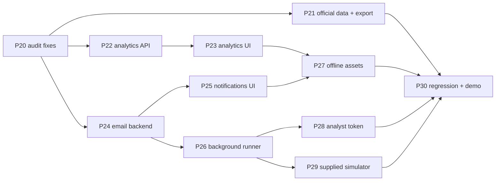

# 02 · Development plan v2 + v2.1 (phases 20–36)

Continues the v1 build (phases 0–19 are done). Everything below adds to the existing project; nothing in the frozen contract (`app/models.py`) changes.

---

## 1. Goals of v2

1. **Prove performance on the official data** and beat the official baseline (the actual judging criteria).
2. **Detection analytics**: an attack-activity heatmap plus a clear answer to "which works better, rules or ML?"
3. **Admin email alerts**: a short summary emailed to the company admin when suspicious activity is detected.
4. **Harden the demo**: background re-runs, offline assets, optional analyst token, supplied-simulator adapter.
5. **v2.1:** show all **15 agents** working; a **Live scan** with full-color output and full JSON of each step; **one audit entry per detected threat**; **input-only data entry**; and an **Attack Path Explorer** graph that impresses judges.

## 2. Ground rules for v2 (also in `05_CONTEXT_V2_ADDENDUM.md`)

- **No new dependencies.** Email uses `smtplib`, `ssl` and `email` from the standard library; HTTP uses `urllib`; the heatmaps are HTML/CSS grids, so no chart plugin is needed.
- **No real cloud enforcement.** No boto3, no Okta API, no `requests`.
- `app/models.py` stays frozen. New endpoints return `clean_json()` dicts.
- `app/config.py` changes are **append-only** (the v2 block in `reference/REF_01_config_v2_block.md`).
- Reference code in `kit_v2/reference/` is pre-tested. Copy it exactly; do not regenerate it.

---

## 3. Phase overview

| Phase | Name | Priority | Time | Owner | Main files |
|---|---|---|---|---|---|
| 20 | Audit verification and consistency fixes | Must | 30 min | A | `context.md`, `app/config.py` (append), detectors/correlation (constants only), `AUDIT_REPORT.md` |
| 21 | Official data run, baseline comparison, export, latency | Must | 60 min | A + B | `app/ingest/normalize.py` (mapping fixes only), `app/evaluation.py`, `app/export.py`, `app/replay.py` |
| 22 | Analytics backend | Must | 25 min | C | `app/analytics.py`, `app/api/analytics.py`, `app/main.py` (1 router line), tests |
| 23 | Analytics page UI (heatmaps + comparison) | Must | 45 min | D | `static/analytics.html`, `static/js/analytics.js`, `layout.js`, `api.js`, mocks |
| 24 | Email notifier backend | Must | 30 min | A | `app/notify.py`, `app/api/notifications.py`, `app/main.py`, `.env.example`, tests |
| 25 | Notifications UI + "Email admin" button | Must | 35 min | D | `static/notifications.html`, `static/js/notifications.js`, `alert.js`, `layout.js`, `api.js`, mocks |
| 26 | Background pipeline runs | Should | 25 min | A | `app/runner.py`, `app/main.py`, `app/api/health.py`, `app/api/alerts.py`, `layout.js` |
| 27 | Offline assets (vendor CDN files) | Should | 15 min | D | `static/vendor/*`, all HTML heads |
| 28 | Optional analyst token for write actions | Could | 25 min | A | `app/security.py`, routers, `api.js` |
| 29 | Supplied simulator adapter | Could* | 20 min | A | `app/simulator/supplied.py` |
| 30 | Regression, docs, demo update | Must | 30 min | All | tests, `README.md`, `AUDIT_REPORT.md` |
| 31 | 15-agent trace, threat audit entries, terminal scan | Must | 40 min | A | `app/trace.py`, `app/scan.py`, `app/pipeline.py` (trace wrappers), `app/api/scan.py` |
| 32 | Agents dashboard (15 agents) | Must | 35 min | D | `static/agents.html`, `static/js/agents.js` |
| 33 | Live scan page (full color + full JSON) | Must | 20 min | D | `static/scan.html`, `static/js/scan.js` (pre-built) |
| 34 | Input-only data entry: backend | Must | 30 min | B | `app/inputs.py`, `app/api/inputs.py`, `app/pipeline.py` (`input_mode`) |
| 35 | Input page UI | Must | 40 min | D | `static/input.html`, `static/js/input.js` |
| 36 | Attack Path Explorer (graph upgrade) | Must | 40 min | A + D | `app/api/identities.py`, `static/js/graph.js` + `graphfx.js` (pre-built) |

\* Phase 29 becomes **Must** as soon as the organizers publish the simulator interface.

**Run order:** 20 → 21 → 22 → 23 → 24 → 25 → 26 → 27 → **31 → 32 → 33 → 34 → 35 → 36** → (28, 29 optional) → **30 last** (final regression).
Phase 26 must come before 31: it installs the trace module and the v2.1 runner.

**Total:** about 9 hours of work, or about 4–4.5 hours in parallel across 4 people. If time is short, cut 27, 28 and 29 first, then 22–23 (analytics), but never 21, 31, 33 or 36.

---

## 4. Parallel schedule (4 people)

| Slot | Person A (backend lead) | Person B (data) | Person C (ML/analytics) | Person D (UI) |
|---|---|---|---|---|
| 0:00–0:30 | P20 audit fixes | P21 part A: data recon | P22 analytics backend | P23 analytics UI with `?mock=1` |
| 0:30–1:30 | P24 email backend | P21 parts B–D: mapping fixes, official run, export | Help B: threshold tuning on official labeled samples | P23 finish → P25 UI with `?mock=1` |
| 1:30–2:00 | P26 runner | P21 latency replay | Verify analytics on official data | P27 vendor assets |
| 2:00–2:30 | P28 (optional), P29 (if interface known) | Final metrics table for slides | Rules-vs-ML numbers for slides | Live wiring of P23/P25 |
| 2:30–3:00 | P30 regression (all) | P30 | P30 | P30 + demo rehearsal |

**Merge rule:** each phase touches only the files listed. Pull before you start a phase and commit right after its CHECK passes.

---

## 5. Dependency graph

UI phases (P23, P25) can start right away using mock JSON; they only need the endpoint shapes from the specs.

---

## 6. New API surface (summary)

| Method | Path | Phase | Returns |
|---|---|---|---|
| GET | `/api/analytics/detectors` | 22 | Rules vs ML vs Hybrid metrics, recall matrix, agreement, winner |
| GET | `/api/analytics/heatmap/time?days=14` | 22 | Date × hour attack counts |
| GET | `/api/analytics/heatmap/identities?top=10` | 22 | Identity × detector signal counts |
| GET | `/api/notifications?limit=50` | 24 | Notification history |
| GET | `/api/notifications/status` | 24 | Mode, recipients, rate limit |
| POST | `/api/notifications/test` | 24 | Sends a test email |
| POST | `/api/alerts/{id}/notify` | 24 | Emails the admin about one alert |
| GET | `/api/pipeline/status` | 26 | Background run state |
| POST | `/api/pipeline/run` | 26 (changed) | Now `202 Accepted` + status (`409` if already running) |

## 7. New UI surface (summary)

| Page / element | Phase |
|---|---|
| `analytics.html`: winner banner, Rules/ML/Hybrid cards, metrics chart, detection heatmap, agreement, attack-time heatmap, identity heatmap | 23 |
| `notifications.html`: email status, test button, history with previews | 25 |
| Alert detail: "Email admin" button | 25 |
| Top bar: live "Pipeline running…" state while re-running | 26 |
| Sidebar: new items "Analytics" and "Notifications" | 23, 25 |

---

## 8. Definition of done for v2

- [ ] `pytest -q` passes (old tests + 10 new reference tests + new API tests).
- [ ] `python smoke_test.py` passes.
- [ ] Official data loads with fewer than 1% skipped records, and the mapping gaps are documented.
- [ ] Metrics table: our event F1 and session precision vs the official baseline.
- [ ] `python -m app.export` writes event and session prediction files.
- [ ] Analytics page shows the winner and both heatmaps on live data and in `?mock=1`.
- [ ] A pipeline run produces exactly one email digest (outbox or SMTP); a repeat run sends none.
- [ ] "Email admin" and "Send test email" work and appear in the audit log.
- [ ] Re-run pipeline works without freezing the UI; a failed run keeps the old results.
- [ ] The console works with Wi-Fi off (after P27).
- [ ] `AUDIT_REPORT.md` corrected; `README.md` updated; demo script rehearsed.
